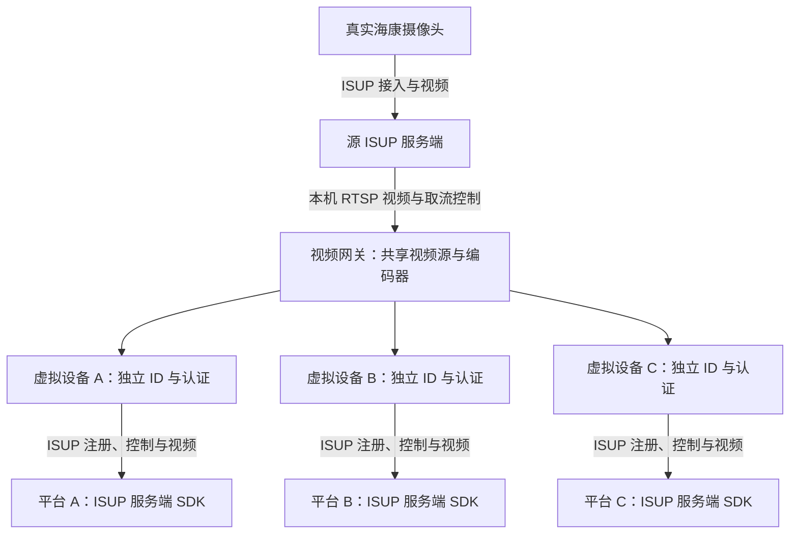

# ISUP 多平台实时视频网关

**让一台海康摄像头，以独立设备身份接入多个 ISUP 平台，让各平台通过自己的 ISUP SDK 获取实时画面。**

适用于“一台摄像头需要同时提供给三个平台观看”“已有摄像头接入一个中心，还要对接其他 ISUP 平台”等视频集成需求。

关键词：**海康摄像头 · ISUP 5 · EHome · 多平台接入 · 实时预览 · 视频网关 · 虚拟 ISUP 设备 · 一源多平台**

> 本仓库公开介绍项目的应用场景、接入方式与实测能力，不提供网关源码或海康 SDK。需要部署、演示或客户平台联调，可通过文末微信二维码联系。

## 你可能遇到的需求

摄像头已经接入一个 ISUP 平台，但业务方又要求把同一画面提供给另外的平台。每个平台都有自己的接入地址、端口、设备 ID 和认证信息，而且希望沿用现有的 ISUP SDK 取流流程。

例如，以下场景都可能需要一台设备同时服务多个独立平台：

| 应用场景 | 具体需求 |
| --- | --- |
| 园区与企业平台 | 园区管理平台、企业总部平台、第三方运维平台分别查看同一摄像头的实时画面 |
| 项目多方交付 | 同一项目的多个业务系统均要求按 ISUP 接入，各自维护设备和预览权限 |
| 平台并行运行 | 原平台继续使用，同时把实时画面接入新的 ISUP 平台进行联调或过渡 |
| 视频集成服务 | 客户提供多个平台的接入信息，希望统一完成设备映射和实时预览对接 |

这些是项目适用场景示例，不代表已交付的客户案例。

## 网关如何工作

摄像头接入源 ISUP 服务端后，网关读取其实时视频，并为每个目标平台维护独立的虚拟 ISUP 设备身份。目标平台按照正常的设备预览流程，通过自己的 ISUP SDK 发起取流，网关向该平台发送对应会话的视频数据。

图中三个目标展示部署方式，具体平台兼容性需要逐一联调。摄像头到源服务端、网关到目标平台的接入和视频传输使用 ISUP；网关内部读取视频使用本机 RTSP。目标平台收到视频之后，可使用自己的播放器或转码方案展示画面，浏览器播放通常采用 WebRTC、HLS 等方式。

## 能解决什么

- **保留摄像头当前接入方式。** 摄像头继续连接源 ISUP 服务端，由网关负责新增目标平台的接入。
- **每个平台看到自己的设备。** 分别配置目标地址、端口、设备 ID、设备名称及认证密钥，便于匹配各平台的设备管理规则。
- **沿用目标平台的 SDK 取流流程。** 目标平台通过 ISUP SDK 发起实时预览，网关处理预览指令并建立媒体会话。
- **共享一路视频源。** 多个目标同时预览时，共享源视频和编码器，各目标拥有独立的注册连接与媒体会话。
- **独立控制各路预览。** 一个目标停止取流时，其他正在预览的目标继续接收；最后一个目标停止后，网关释放源取流。
- **按项目配置转发关系。** 可以配置三个目标，也可以按实际需求增减目标；并发规模取决于服务器、编码能力和网络带宽。

每个目标平台都需要有可用的 ISUP 服务端，并允许对应虚拟设备注册。当前源接入已适配项目使用的 cam 服务端；其他源平台需评估取流接口并进行适配。

## 已经验证到哪一步

**已完成真实摄像头 → 源 ISUP 平台 → 网关 → 另一台服务器的海康 ISUP SDK → 浏览器实时画面的链路验证。**

2026-10-06 的测试中，目标服务端 SDK 版本为 `2.5.1.35`，确认了以下结果：

| 验证项目 | 实测结果 |
| --- | --- |
| 虚拟设备接入 | 使用新的设备身份完成 ISUP 注册与上线 |
| SDK 发起预览 | 目标 CMS SDK 成功建立预览会话并下发推流指令 |
| SDK 接收码流 | 目标 Stream SDK 接到媒体连接，设置预览数据回调成功，收到的字节数持续增长 |
| 视频内容可用 | SDK 回调输出的 PS 数据可解析、解码，并显示真实摄像头画面 |
| 连续实时性 | 一次约 8 秒的观察中，接收端解析帧数增加 200 帧，约为 25fps |
| 多会话共享源 | 同一目标平台上的两个独立虚拟设备会话同时取流，共用一个源编码器；停止其中一路后，另一路继续运行 |

当前完成了 **一个外部目标平台** 的接入，以及 **同平台两个设备会话** 的并发验证。三个不同客户平台的同时接入，应结合各平台的 SDK 版本、认证方式和取流配置分别完成测试。

## 当前交付范围

项目聚焦于 **ISUP 实时预览接入和多平台视频转发**。

| 项目 | 当前范围 |
| --- | --- |
| 协议与传输 | ISUP 5，TCP 实时视频 |
| 设备与通道 | 每个虚拟设备提供单通道实时画面 |
| 视频配置 | 当前验证为 HEVC / H.265，704 × 576，25fps，无音频 |
| 目标服务端 | 已在上述海康 ISUP 服务端 SDK 上验证，其他版本需联调 |
| 视频处理 | 当前经过转码，原始分辨率与原始码流透传需要另行适配验证 |
| 其他能力 | 回放、云台控制、报警转发、UDP 和媒体加密尚未实现 |

如果客户已有明确的分辨率、编码格式或扩展功能要求，可在对接前提供需求，评估适配范围。

## 常见问题

### 客户平台是不是通过 ISUP SDK 获取视频？

是。已经验证的目标平台通过 CMS SDK 发起预览，通过 Stream SDK 的预览数据回调接收网关发送的视频。平台收到数据后，再选择自己的显示或分发方式。

### 是不是相当于多个虚拟摄像头？

可以这样理解。真实视频来自同一台摄像头，但网关在各目标平台上使用独立的设备身份、认证信息和预览会话。不同平台可以使用不同的设备 ID 和名称。

### 只给三个平台的 IP 和端口就够了吗？

还需要各平台的设备 ID、认证密钥及设备接入许可。注册地址与媒体接收地址也可能不同；默认使用目标 SDK 下发的媒体地址，必要时可配置覆盖地址。

### 摄像头自身有多个中心配置，还需要网关吗？

先确认具体型号和固件是否支持多个 ISUP 中心同时在线、同时预览。如果原生能力已满足业务需求，可以直接使用设备配置；需要统一映射设备身份或扩展目标接入时，再评估网关。多个中心配置的实际含义应以设备说明和现场测试为准。

### 目标平台必须有域名或使用 80 端口吗？

ISUP 接入主要取决于注册和媒体地址的可达性。网页访问地址与 ISUP 端口分别配置，演示平台可以采用 IP 加自定义网页端口。

## 合作与接入评估

适合有 **海康 ISUP / EHome 实时视频接入、多平台共享画面、虚拟设备映射或平台联调** 需求的集成商、平台开发团队与项目交付团队。

可以联系沟通需求评估、现有能力演示、网关部署、设备映射配置及客户平台联调。具体方案与交付范围根据设备、平台和网络条件确定。

联系时建议说明：

1. 摄像头型号、固件版本及当前接入方式。
2. 需要接入的平台数量、ISUP 版本和服务端 SDK 版本。
3. 画面分辨率、帧率、音频及同时预览要求。
4. 服务器部署环境及网络可达性。

公开 GitHub Issue 可用于一般需求讨论；接入密码、认证密钥和实际设备信息请通过私下沟通提供。

## 联系我

**微信扫码添加，备注「ISUP 网关」及你的项目需求。**

